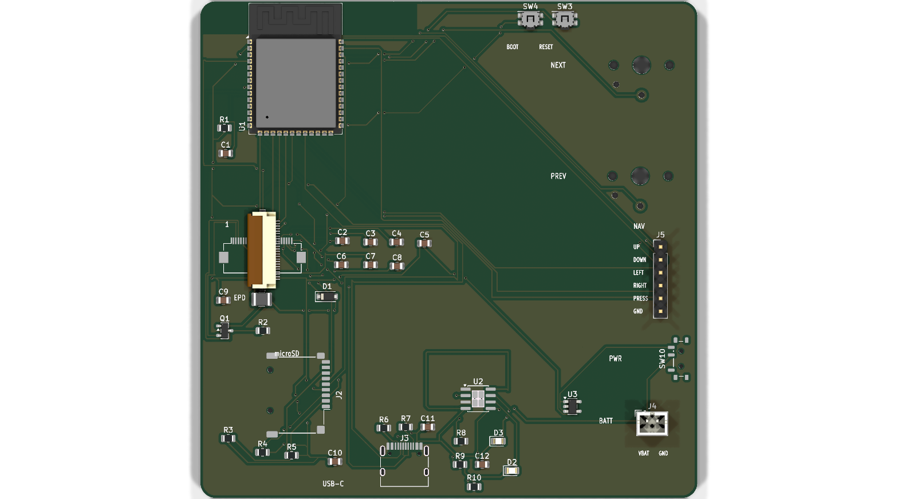
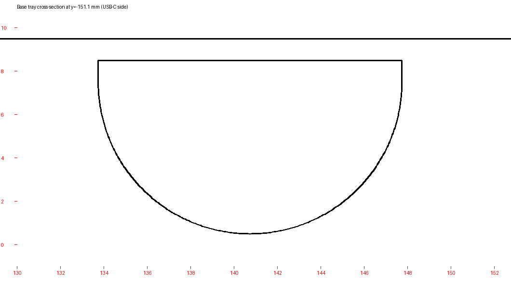

# Ohara-75 !!!!!!!!!!!!!!!!!!!!!!!!!!!



> A e-ink-reader !!!!!!!!!!!!!!! with one piece features !!!!!!!!!! powered by esp32 and a e-paper screen for reading manga or novels with 0 eye strain


**hi this is my first readme for my 3rd pcb project !!!!!!!! pls dont judge my spelling i am 13 and i type too fast :sob:**
**also this is the same voice as my JOURNAL.md because that is just how i write ok !!!!!!!**

---

## WAIT WHAT IS THIS?????

Ohara-75 is a handheld e-ink reader i made for reading **MANGA** and novels with **0 eye strain** !!!!!!!!!

it has a 7.5 inch e-paper screen, an ESP32-S3, a microSD card for all my offline books, a LiPo battery, USB-C charging, two Kailh Choc page buttons, and a 3D printed case. it is 98x98mm because JLCPCB is cheap only until the 100x100 limit !!!!!!! (i wanted a straw hat shaped edge cut at first but then i realized a e-reader needs a rectangle :C)

i am planning to use this for my entire school years so it is not just SOME project for me !!!!!!!!!!!

---

## FEATURES !!!!!!!!!

- 7.5 inch e-paper, 800x480, 1-bit, 0 eye strain when reading at 2am
- ESP32-S3-WROOM-1 running MicroPython
- microSD card slot (i have a 32GB card for offline manga/novels)
- USB-C for charging and programming
- TP4056 LiPo charger + AP2112K 3.3V regulator
- LiPo battery connector (JST PH)
- 2x Kailh Choc page buttons because turning pages with a 5-way is slow
- 5-way navigation header (up/down/left/right/press)
- power switch, reset button, boot button
- silkscreen labels for every port: USB-C, microSD, EPD, BATT, NAV, plus every nav pin (UP/DOWN/LEFT/RIGHT/PRESS/GND), battery pins (VBAT/GND), and NEXT/PREV/PWR/BOOT/RESET
- 3D printed base tray + lid (STLs are in `3d/`)
- U-shaped USB-C cable hole in the base tray !!!!!!!!!

---

## THE USB-C CABLE HOLE !!!!!!!!!

the USB-C port is on the bottom edge of the PCB, so i added a little U-shaped pass-through in the base tray. it is 14mm wide and 8mm tall, centered at **x = 140.75mm** (same as the USB-C connector), and it goes through the 2.2mm front wall. now a USB-C cable can loop up into the port without drilling a ugly hole myself !!!!!!!!!



the file is `3d/Ohara-75-Base-Tray.stl`. the lid is `3d/Ohara-75-Lid.stl`.

---

## SILKSCREEN PIN LABELS !!!!!!!!!

i labeled the pins like i did on my Starbie and Tone Dial boards. headers get one label per pin so you dont have to keep the schematic open while soldering !!!!!!!!

| port | labels |
| :--- | :--- |
| **J5 NAV 6-pin** | 1 UP · 2 DOWN · 3 LEFT · 4 RIGHT · 5 PRESS · 6 GND |
| **J4 BATT 2-pin** | 1 VBAT · 2 GND |
| **J1 EPD FPC** | `EPD` + pin-1 marker (0.5mm pitch is too tiny for all 24 labels) |
| **J2 microSD** | `microSD` |
| **J3 USB-C** | `USB-C` |

the page buttons and power switch are also labeled `NEXT`, `PREV`, and `PWR`, and the tiny buttons are `BOOT` and `RESET`. all of this is on the **front silkscreen**.

---

## THE BIG Q1 OOPS !!!!!!!!! (READ THIS BEFORE YOU BUILD)

ok so this is the part where i have to be honest. the MOSFET Q1 on the PCB is wired wrong in the current netlist.

**current / wrong wiring:**

- Q1 pin 1 (G) -> switch node
- Q1 pin 2 (S) -> `/EPD_GDR`
- Q1 pin 3 (D) -> `/EPD_RESE`

**correct wiring:**

- Q1 pin 1 (G) -> `/EPD_GDR`
- Q1 pin 2 (S) -> `/EPD_RESE`
- Q1 pin 3 (D) -> switch node (the L1/D1 side)

if you build the board as-is the e-paper boost supply will not work and the screen will stay white. you need to rework Q1 or add jumper wires. i found this with my dad while checking the schematic and i am fixing it in the next revision !!!!!!!! **DO NOT FORGET THIS PART !!!!!!!!!**

---

## FILES IN THIS REPO !!!!!!!!!

```text
Ohara-75.kicad_pcb        the PCB (with port labels on the silkscreen)
Ohara-75.kicad_sch        the schematic
Ohara-75.kicad_pro        KiCad project
Ohara-75.step             PCB 3D model
Ohara-75.pretty/          my custom footprints
fp-lib-table              footprint library table
JOURNAL.md                my Half Life devlog (the origin of this readme voice)
BOM.csv                   bill of materials (still a work in progress lol)
firmware/frimware.py      the simple ~100 line beginner firmware
firmware/archive/         the full production firmware
3d/Ohara-75-Base-Tray.stl base tray with the USB-C U-hole
3d/Ohara-75-Lid.stl       front lid / bezel
images/                   renders used in this readme
```

---

## HOW TO BUILD IT !!!!!!!!!

1. **Order the PCB.** it is 98x98mm so it fits the cheap JLCPCB size. use 1.6mm thickness and HASL is fine.
2. **Solder everything.** ESP32-S3, USB-C, microSD, EPD FPC connector, TP4056, AP2112K, passives, buttons, battery connector. the FPC connector is 0.5mm pitch so please use flux and a microscope if you have one.
3. **FIX Q1.** read the big warning above. G -> `/EPD_GDR`, S -> `/EPD_RESE`, D -> switch node.
4. **Print the case.** print `3d/Ohara-75-Base-Tray.stl` and `3d/Ohara-75-Lid.stl`. the base already has the USB-C cable hole.
5. **Flash MicroPython** for the ESP32-S3.
6. **Copy the firmware.** the simple one is `firmware/frimware.py`. copy it to the board and rename it to `main.py` (or import it from your own `main.py`). the full one is in `firmware/archive/firmware_production.py` if you want menus, bookmarks, settings, sleep, etc.
7. **Copy books to the SD card.** for the simple firmware make a FAT32 card with `/sd/book.txt`. for the full firmware use `/sd/books/` and put `.txt` or `.md` files there.
8. **Plug in USB-C and pray.** if the screen is white, check Q1 first. i am serious !!!!!!!!

---

## HOW TO USE IT !!!!!!!!!

### Simple firmware (`firmware/frimware.py`)

- **NEXT** / **PREV** page buttons turn pages
- it reads `/sd/book.txt`
- it uses fixed-width wrapping (it does not do fancy word wrap, sorry)
- no menus, no settings, no bookmarks, no sleep. just reading !!!!!!!!

### Full firmware (`firmware/archive/firmware_production.py`)

- **UP / DOWN** move in menus
- **PRESS** select
- **LEFT** back
- **NEXT / PREV** or **LEFT / RIGHT** turn pages in the reader
- **PRESS** in the reader opens the book menu
- bookmarks, jump to page, settings, theme, line spacing, fast/full refresh, auto sleep, SD progress saving !!!!!!!!

---

## WHAT WENT WRONG / TODO !!!!!!!!!

- [x] design the PCB
- [x] route the PCB
- [x] make the case
- [x] add the USB-C cable hole
- [x] add port labels to the silkscreen
- [x] write the simple firmware
- [x] write the full firmware
- [ ] **FIX Q1 AND ORDER REV 2** (this is the big one)
- [ ] test the e-paper on real hardware
- [ ] add manga/CBZ support (right now it is text only, sorry)
- [ ] add a battery voltage divider so the battery percentage actually works
- [ ] make the case look nicer (maybe straw hat vents next time?)
- [ ] read way too much manga and call it testing

---

## WHY I MADE THIS

i wanted a e-reader that i can use for school and for manga without staring at a bright LCD all day. i researched the ESP32-S3 and the 7.5 inch e-paper, picked a 32GB microSD so i can read offline, and designed the whole thing in KiCad. this is my 3rd PCB and it was really hard to manage the schematic, placement, routing, DRC errors, and the case all at once !!!!!!!!

the routing was a **PDB DEADLOCK** at one point :C and i had like 50 DRC errors at the end. most of them were thermal relief and minimum drill hole stuff. i fixed them and rounded my hours to a clean number because messy numbers are annoying.

also i wanted a straw hat shaped edge cut like my week 1 starbie and week 3 tone dial, but a e-reader needs a rectangle so i used a normal rounded rectangle. maybe rev 2 gets a straw hat logo on the silkscreen instead !!!!!!!!

---

## THANKS !!!!!!!!!

- **Hack Club / Half Life** for making me actually finish this
- all the **HC reviewers** who read my devlog (sorry for the spelling)
- my dad for helping me find the Q1 problem
- **Waveshare** for the MIT licensed 7.5 inch e-paper init code
- **KiCad**, **JLCPCB**, and everyone who answered my questions
- and you for reading this README !!!!!!!!!!!!!!!!!!

---

## LICENSE

the e-paper init sequences are adapted from Waveshare's MIT licensed driver, so those bits stay MIT. everything else is my project. if you build one please credit me and send me a picture !!!!!!!! i am not a lawyer lol.

**Thx for reading !!!!!!!! :D**
